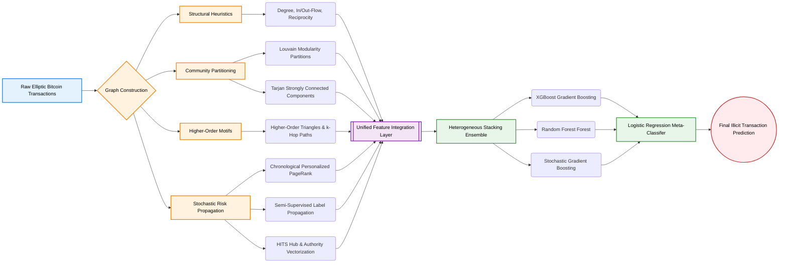

# Graph-Based Fraud Detection System (Elliptic Data Set)

A comprehensive Python framework for detecting illicit transactions in the Elliptic Bitcoin dataset using advanced Graph Neural Networks, Community Detection, and Meta-Learning approaches.

## Setup & Execution

### Prerequisites
The project uses `uv` for dependency management. All datasets are dynamically downloaded via `kagglehub` on the first run, so no manual dataset fetching is required.

```bash
# Install dependencies
uv sync

# Run the benchmark pipeline
uv run main.py
```

## 🏆 The State-of-the-Art Architecture: Unified Multi-Stage Detection Framework (S11)

Through empirical benchmarking against 10 other architectural designs, our **Unified Multi-Stage Detection Framework** (Strategy 11) emerged as the definitive champion. This architecture leverages a multi-faceted ensemble of meta-learning concepts to achieve state-of-the-art anomaly detection on large-scale transaction networks.

### Architecture Topology



### High-Level Component Explanations

1. **Topological Motifs:** Extracts the atomic structural roles (higher-order triangle formations) to identify structured tumbling and money laundering efforts.
2. **Community Partitions (Louvain & SCC):** Identifies macro-clusters and cyclic formations. Illicit actors often operate in dense rings to obfuscate flow. 
3. **Risk propagation (C-PPR & LP):** Utilizes seeds of known illicit entities to run a Modified Chronological Personalized PageRank. It calculates "risk-by-association" across multiple hops.
4. **Stacking Ensemble:** A Logistic Regression meta-classifier handles the final decision boundary, optimally weighting sub-predictions from XGBoost, Gradient Boosters, and Random Forests.

### The 25 Features in S11

The S11 strategy concatenates 25 features (not averaged) into a single vector per node:

| # | Feature | Source |
|---|---------|-------|
| 1 | `total_deg` | degree |
| 2 | `in_deg` | degree |
| 3 | `out_deg` | degree |
| 4 | `in_flow` | degree |
| 5 | `out_flow` | degree |
| 6 | `flow_imbalance` | computed |
| 7 | `tx_count` | degree |
| 8 | `ppr_scores` | PageRank (fraud-seeded) |
| 9 | `comm_sizes` | Louvain |
| 10 | `clustering` | clustering coeff |
| 11 | `hub_scores` | HITS |
| 12 | `auth_scores` | HITS |
| 13 | `avg_neighbor_deg` | avg neighbor degree |
| 14 | `scc_flags` | Tarjan SCC |
| 15 | `out_flow / in_flow` | flow ratio |
| 16 | `tri` | triangles (S08) |
| 17 | `scc_sizes` | Tarjan SCC |
| 18 | `two_paths` | S08 motifs |
| 19 | `reciprocity` | S08 motifs |
| 20 | `s` | label propagation |
| 21 | `np.mean(nb_scores)` | label propagation |
| 22 | `np.max(nb_scores)` | label propagation |
| 23 | `pt` | time-weighted PPR (fraud) |
| 24 | `pr` | time-weighted PPR (legit) |
| 25 | `pt / pr` | risk ratio |

**Combination Mechanism:**
1. Features are **concatenated** → 25-dim vector per node
2. StandardScaler normalizes each dimension
3. All 25 features fed to stacking ensemble (RF + XGB + GB)
4. LogisticRegression meta-learner learns optimal combination weights

## Experimental Framework & Comparison Benchmarks

The framework executes 12 distinct isolated methodologies in parallel (using `multiprocessing`) to evaluate their relative effectiveness on Bitcoin transaction networks. Results are output to the `./results` directory.

### Strategies Evaluated:

* `s00_topological_baseline.py`: Basic I-hop graph heuristics.
* `s01_structural_feature_augmentation.py`: Classic Social Network Analysis (SNA) metrics. 
* `s02_multi_resolution_community_detection.py`: Unsupervised multi-scale clustering.
* `s03_associative_propagated_risk_2hop.py`: Multi-hop guilt-propagation algorithms.
* `s04_heterogeneous_stacking_ensemble.py`: Base ensemble learning implementations. 
* `s05_spatio_temporal_feature_fusion.py`: Spatio-temporal transactional heuristics. 
* `s06_latent_graph_embeddings_node2vec.py`: Latent graph-embedded transformations.
* `s07_chronological_risk_propagation.py`: PPR adjusted with chronological weights.
* `s08_higher_order_flow_motifs.py`: Complex flow-cycle topology.
* `s09_semi_supervised_identity_propagation.py`: Iterative label-inference algorithms.
* `s10_composite_multi_feature_ensemble.py`: Deep structural feature integration.
* `s11_unified_multistage_detection_framework.py`: The champion architectural framework.
