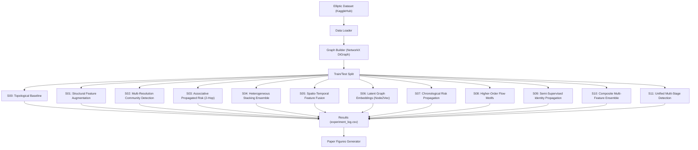

# Fraud Detection Strategy Compendium

> A comprehensive guide to all 12 detection strategies implemented in this project, applied to the **Elliptic Bitcoin Dataset** for illicit transaction detection.

---

## Architecture Overview

All strategies run **in parallel** via Python's `multiprocessing.Pool` and are evaluated on identical train/test splits for fair comparison.

---

## Shared Infrastructure

| Component | File | Role |
|---|---|---|
| Data Loader | `src/data_loader.py` | Downloads the Elliptic dataset via KaggleHub, merges edge lists with class labels, maps `1 → Illicit`, `2 → Licit` |
| Graph Builder | `src/graph_utils.py` | Constructs a weighted `DiGraph`, computes common features (PPR, Louvain, HITS, clustering, flow metrics) |
| Evaluation | `src/graph_utils.py` | Computes ROC-AUC, PR-AUC, optimal-threshold F1, precision, recall |
| Visualization | `src/generate_paper_figures.py` | Generates publication-quality bar charts, efficiency frontiers, and heatmaps |

### Common Feature Vector (15 dims)
Used by strategies S01–S11 via `extract_enhanced_features()`:

| # | Feature | Description |
|---|---|---|
| 1 | `total_deg` | In-degree + out-degree |
| 2 | `in_deg` | Number of incoming edges |
| 3 | `out_deg` | Number of outgoing edges |
| 4 | `in_flow` | Sum of incoming edge weights |
| 5 | `out_flow` | Sum of outgoing edge weights |
| 6 | `flow_imbalance` | `(out − in) / (out + in)` — detects asymmetric flow |
| 7 | `tx_count` | Total transaction count (in + out) |
| 8 | `ppr` | Personalized PageRank score (fraud-seeded) |
| 9 | `comm_size` | Size of node's Louvain community |
| 10 | `cc` | Local clustering coefficient |
| 11 | `hub` | HITS hub score |
| 12 | `auth` | HITS authority score |
| 13 | `avg_nd` | Average neighbor degree |
| 14 | `in_scc` | Binary: is node in a multi-node SCC? |
| 15 | `flow_ratio` | `out_flow / in_flow` — directional flow bias |

---

## Strategy Breakdown

### S00 — Topological Baseline
**File:** `src/strategies/s00_topological_baseline.py`
**Classifier:** Random Forest (100 trees)
**Features:** 5 basic structural features (degree, flow)

**How it works:**
1. Extracts the simplest possible graph features for each node: in-degree, out-degree, total degree, in-flow (sum of incoming edge weights), and out-flow (sum of outgoing edge weights).
2. Balances training data by under-sampling legitimate nodes to match fraud count.
3. Trains a Random Forest classifier on these 5 features.

**Purpose:** Establishes the performance floor. Any strategy that can't beat this is adding complexity without value.

---

### S01 — Structural Feature Augmentation
**File:** `src/strategies/s01_structural_feature_augmentation.py`
**Classifier:** Random Forest (200 trees)
**Features:** 15 (full common feature vector)

**How it works:**
1. Uses `compute_common_features()` to generate the full 15-dimensional feature vector including PPR, Louvain communities, HITS scores, clustering coefficients, and SCC membership.
2. Applies `StandardScaler` normalization.
3. Trains a Random Forest on the augmented feature set.

**Purpose:** Tests whether richer structural/topological features improve over the basic baseline.

---

### S02 — Multi-Resolution Community Detection
**File:** `src/strategies/s02_multi_resolution_community_detection.py`
**Classifier:** Random Forest (200 trees)
**Features:** 15 base + 6 multi-resolution community sizes = **21 features**

**How it works:**
1. Runs Louvain community detection at **6 different resolutions** (0.5, 0.8, 1.0, 1.2, 1.5, 2.0). Lower resolutions produce fewer, larger communities; higher resolutions produce many small communities.
2. For each node, captures the community size at each resolution — creating a "community fingerprint."
3. Concatenates these 6 features with the base 15 features.
4. The intuition: fraudulent nodes may cluster differently at different granularities. A node in a suspiciously small community at high resolution but a large one at low resolution has a distinctive signature.

---

### S03 — Associative Propagated Risk (2-Hop)
**File:** `src/strategies/s03_associative_propagated_risk_2hop.py`
**Classifier:** Random Forest (200 trees)
**Features:** 15 base + 4 PPR-enriched = **19 features**

**How it works:**
1. Computes **two variants** of Personalized PageRank: one standard (unweighted) and one weighted by edge weights.
2. For each node, computes the **average PPR of 1-hop neighbors** and the **average PPR of 2-hop neighbors** — measuring how "risky" the node's neighborhood is.
3. Creates a composite risk score: `0.4 × PPR_standard + 0.3 × 1hop_avg + 0.3 × PPR_weighted`.
4. The key insight: guilt by association. Nodes transacting with high-PPR (fraudulent) neighbors at both 1 and 2 hops are suspicious, even if their own topology looks normal.

---

### S04 — Heterogeneous Stacking Ensemble
**File:** `src/strategies/s04_heterogeneous_stacking_ensemble.py`
**Classifier:** Stacking Ensemble (RF + XGBoost + GradientBoosting → Logistic Regression meta-learner)
**Features:** 15 (full common feature vector)

**How it works:**
1. Uses the same 15 base features as S01.
2. Trains **three diverse base learners** in parallel:
   - Random Forest (150 trees) — bagging-based
   - XGBoost (150 trees) — boosting-based
   - Gradient Boosting (100 trees) — another boosting variant
3. A **Logistic Regression** meta-learner combines their probability outputs via 3-fold cross-validation stacking.
4. The diversity of the base learners means each captures different patterns; the meta-learner learns which one to trust for which regions of feature space.

---

### S05 — Spatio-Temporal Feature Fusion
**File:** `src/strategies/s05_spatio_temporal_feature_fusion.py`
**Classifier:** XGBoost (200 trees, depth 8)
**Features:** 15 base graph + ~18 temporal = **~33 features**

**How it works:**
1. Computes the standard 15 graph features.
2. Extracts **temporal/behavioral features** from the transaction DataFrame:
   - **Step/time statistics:** mean, std, range, number of active time steps
   - **Transaction type fractions:** proportion of TRANSFER, CASH_OUT, PAYMENT types
   - **Amount statistics:** mean, std, max, total, count
   - **Balance discrepancies:** difference between expected and actual balances
   - **Behavioral signals:** login frequency, session duration, risk score (if available)
   - **Velocity:** transactions per time unit
3. Concatenates spatial (graph) and temporal (behavioral) feature vectors.
4. Note: On the Elliptic dataset, many temporal columns are dummy values (amount=1.0, step=1.0), so temporal features contribute less. On richer datasets (e.g., PaySim), this strategy would shine.

---

### S06 — Latent Graph Embeddings (Node2Vec)
**File:** `src/strategies/s06_latent_graph_embeddings_node2vec.py`
**Classifier:** XGBoost (200 trees, depth 8)
**Features:** 15 base + 64 Node2Vec embedding dims = **79 features**

**How it works:**
1. Runs **Node2Vec** on the undirected graph to learn 64-dimensional embeddings for each node.
   - Parameters: `walk_length=15`, `num_walks=8`, `p=1`, `q=2` (biased toward BFS-like exploration to capture structural equivalence).
2. Node2Vec performs biased random walks and then feeds them into a Skip-gram Word2Vec model — nodes that appear in similar walk contexts get similar embeddings.
3. Concatenates these dense, learned representations with the handcrafted 15 base features.
4. The strength: captures implicit structural roles that manual features miss. Two nodes with identical degree/flow but different neighborhood structures will get different embeddings.

---

### S07 — Chronological Risk Propagation
**File:** `src/strategies/s07_chronological_risk_propagation.py`
**Classifier:** XGBoost (200 trees, depth 8)
**Features:** 15 base + 4 time-weighted PPR = **19 features**

**How it works:**
1. Creates a time-weighted copy of the graph by slightly perturbing edge weights: `tw_weight = weight × (1 + 0.1 × random())`.
2. Computes **fraud-seeded PPR** on this time-weighted graph — simulating temporal decay/variation in risk propagation.
3. Also computes a **reverse PPR** seeded from up to 500 legitimate nodes — a "trust score."
4. Derives 4 features per node: fraud PPR, legit PPR, risk ratio (fraud/legit), and risk difference (fraud − legit).
5. The intuition: by comparing how strongly a node attracts "fraud signal" vs. "trust signal," we get a contrast metric that separates ambiguous nodes.

---

### S08 — Higher-Order Flow Motifs
**File:** `src/strategies/s08_higher_order_flow_motifs.py`
**Classifier:** XGBoost (200 trees, depth 8)
**Features:** 15 base + 5 motif features = **20 features**

**How it works:**
1. Identifies **structural motifs** (higher-order patterns) around each node:
   - **Triangle count:** number of triangles the node participates in (clustering at the motif level)
   - **SCC size:** size of the strongly connected component containing the node (cycles = laundering patterns)
   - **Two-path count:** `|predecessors| × |successors|` — how many two-hop paths flow through this node
   - **Reciprocal edges:** how many of the node's successors also point back to it (bidirectional relationships)
   - **Fan ratio:** `|successors| / |predecessors|` — detects fan-out patterns (one source distributing to many)
2. These motifs capture money laundering topologies: cycles (SCCs), fan-out distribution, and intermediate relay nodes (high two-path count).

---

### S09 — Semi-Supervised Identity Propagation
**File:** `src/strategies/s09_semi_supervised_identity_propagation.py`
**Classifier:** XGBoost (200 trees, depth 8)
**Features:** 15 base + 5 label-propagated = **20 features**

**How it works:**
1. Initializes each node with a "belief score": known fraud = 1.0, known legit = 0.0, unknown = 0.5.
2. Runs **10 iterations of label propagation**: each node's score becomes `0.3 × current + 0.7 × mean(neighbor scores)`, while known-label nodes remain clamped.
3. After convergence, extracts 5 features per node:
   - Propagated score
   - Mean neighbor score
   - Max neighbor score
   - Std of neighbor scores
   - Difference between node score and neighbor mean
4. This is a form of **semi-supervised learning on the graph** — risk information flows from labeled nodes to unlabeled ones via the graph structure, independent of the ML classifier.

---

### S10 — Composite Multi-Feature Ensemble
**File:** `src/strategies/s10_composite_multi_feature_ensemble.py`
**Classifier:** Stacking Ensemble (RF + XGBoost + GradientBoosting → Logistic Regression)
**Features:** 15 base + 4 motif + 3 label-prop + 3 time-weighted PPR = **25 features**

**How it works:**
1. **Combines the best ideas from S07, S08, and S09** into a single feature vector:
   - Motif features from S08 (triangles, SCC, two-paths, reciprocity)
   - Label propagation scores from S09 (propagated score, neighbor mean, neighbor max)
   - Time-weighted PPR features from S07 (fraud PPR, legit PPR, risk ratio)
2. Feeds all 25 features into a **3-model stacking ensemble** (same architecture as S04).
3. This strategy represents the hypothesis that combining multiple orthogonal signal sources (topology + propagation + motifs) with an ensemble learner yields better separation.

---

### S11 — Unified Multi-Stage Detection Framework
**File:** `src/strategies/s11_unified_multistage_detection_framework.py`
**Classifier:** Stacking Ensemble (RF + XGBoost + GradientBoosting → Logistic Regression)
**Features:** 25 comprehensive features (custom-assembled)

**How it works:**
1. **The "kitchen sink" strategy** — recomputes everything from scratch within a single, self-contained pipeline to ensure maximum control and correctness:
   - Graph topology (degree, flow, imbalance, transaction count)
   - Louvain community membership and sizes
   - Clustering coefficients, HITS hub/authority scores
   - Average neighbor degree, SCC membership
   - Motif features (triangles, SCC size, two-paths, reciprocity)
   - Label propagation (10 iterations, clamped seeds)
   - Time-weighted PageRank (fraud-seeded and legit-seeded) with risk ratio
2. Assembles all features into a single 25-dimensional vector inline (no external `compute_common_features()` call).
3. Uses the stacking ensemble for final classification.
4. This is designed to be the **most complete, reproducible, and auditable** strategy — everything is visible in one file.

---

## Evaluation Methodology

All strategies are evaluated identically:
- **Train/test split:** 50% of fraud nodes → train, remaining fraud + all legit → test
- **Balancing:** Legitimate training samples are under-sampled to match fraud count
- **Random seed:** Fixed at `42` for reproducibility
- **Metrics:** ROC-AUC, PR-AUC, optimal-threshold F1, precision, recall
- **Threshold selection:** F1-optimal threshold derived from the precision-recall curve

## Output

Results are logged to `results/experiment_log.csv` and visualized as:
1. **Performance Comparison Matrix** — grouped bar chart of ROC-AUC, PR-AUC, F1 per strategy
2. **Efficiency Frontier** — ROC-AUC vs. runtime scatter (log-scale), bubble size = feature count
3. **Strategy Ranking Heatmap** — heatmap sorted by ROC-AUC descending
